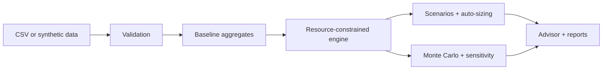

# SIMUL8 AI: What-If Business Simulator
Test the decision. Before you make it.

Tests whether a 20% sales increase can be supported by existing employees, inventory, production capacity and logistics, which resource binds first, what investment is needed, and how profit, investment and service level trade off. Bundled data is **fictional synthetic data**: a home-appliance maker whose workforce (about 90% loaded) and delivery fleet (about 86% loaded) become binding at +20%, while inventory is tight and production has slack.

## How SIMUL8 AI works: the 10-step algorithm
1. **Load and validate.** Read products and resources (or the synthetic demo), reject missing, negative, duplicate or non-numeric values with row references, and warn when the resources cannot serve baseline demand.
2. **Aggregate the baseline.** Convert product data into monthly demand, mix-weighted price, variable cost, labour and machine hours per unit, assuming a constant product mix.
3. **Set the target.** Potential demand = baseline units × (1 + growth) × horizon. Growth is a target, not a guaranteed outcome.
4. **Convert to workload.** Units still to produce (demand minus finished-goods stock) become labour hours, machine hours, material units and shipments over the same horizon.
5. **Compute each capacity.** Workforce (hires after ramp, productivity, overtime), production (lines, shifts, downtime, utilisation limit), inventory (stock plus replenishment, disruption) and logistics (fleet, dispatch efficiency).
6. **Find feasible sales.** Fulfilled = minimum of demand and the units each resource can support; the binding constraint is the lowest, and unmet demand is attributed once.
7. **Cost and profit.** Revenue from fulfilled sales only, variable, delivery, fixed, hiring, overtime, expansion, holding and depreciation costs; a profit bridge reconciles exactly to the change versus baseline.
8. **Size and compare strategies.** Auto-size hires, lines, vehicles and replenishment to close gaps, then compare business as usual, growth with existing resources, targeted expansion and phased growth.
9. **Stress-test.** Seeded Monte Carlo (demand, productivity, downtime, fleet, supply, cost) gives P10/median/P90 and model-based chances; ±10% sensitivity ranks the drivers.
10. **Advise and report.** A deterministic advisor quotes the computed figures, and CSV and HTML reports record settings, definitions, timestamp and simulated-versus-observed labels for human review.

## Architecture


## Run
```
pip install -r requirements.txt
python app.py
```
In Google Colab paste `app.py` into one cell and run it; Gradio prints a public link.

## Sample schema
`products.csv`: product, monthly_units, unit_price, unit_variable_cost, labour_h_per_unit, machine_h_per_unit. `resources.csv` (one row): employees, productive_hours_per_employee_month, productivity_index, machine_lines, shifts_per_day, machine_hours_per_line_shift_month, fleet_vehicles, units_per_vehicle_month, raw_material_stock_units, replenishment_units_month, finished_goods_units, fixed_costs_month. Currency is ₹; capacities are monthly.

## Formulas
Demand = baseline × (1+g) × horizon. Fulfilled = min(demand, stock + labour hours ÷ h/unit, stock + machine hours ÷ h/unit, stock + material supply, delivery capacity). Operating profit = revenue − variable − delivery − fixed − hiring − overtime − expansion − holding − depreciation.

## Testing and limits
`pip install pytest && pytest tests` runs the built-in self-tests. Estimates are not guarantees; this is decision support only. Add screenshots to `screenshots/` (none included).
